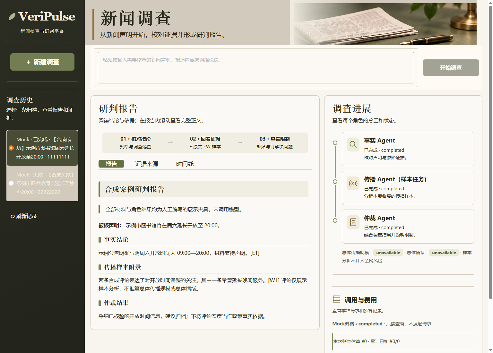
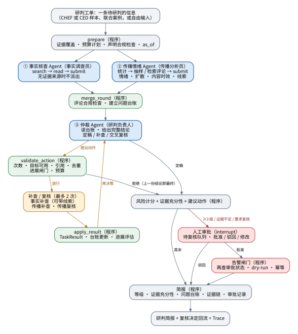
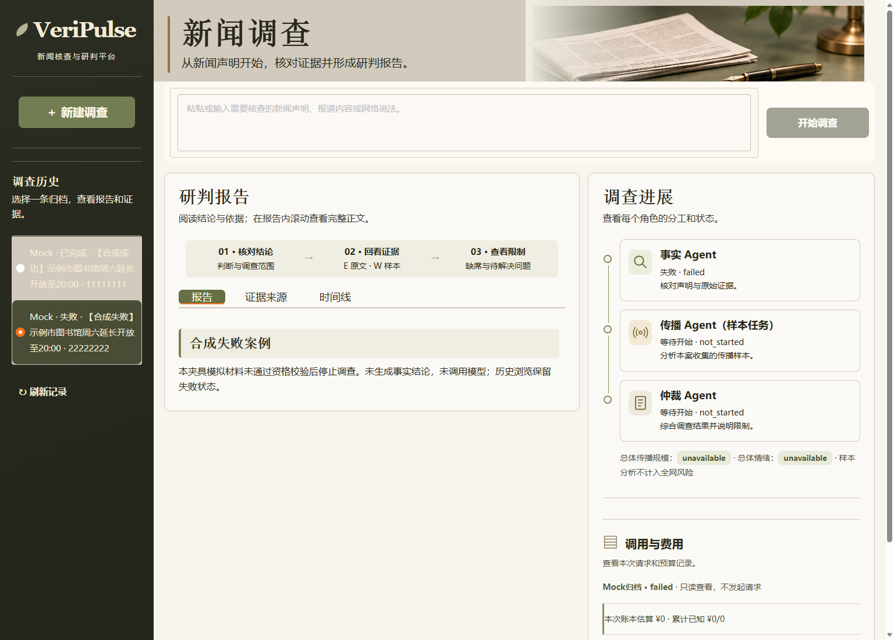

# 项目 A · 证据驱动的多 Agent 舆情研判系统

An evidence-driven multi-agent system for news investigation and risk assessment.  
Combines fact checking, public-comment analysis, and arbitration with traceable citations.  
Built with Python, LangGraph, Gradio, and a shared budget ledger for controlled execution.

**[打开在线 Demo](https://phoeehnn.github.io/veripulse-multi-agent/demo/)** · [本地运行与实时调查](docs/QUICKSTART.md) · [架构说明](docs/ARCHITECTURE.md)

## 关键结果

| 场景 | 结果 | 指标含义与评测范围 |
|---|---|---|
| CHEF 历史测试集事实核查 | **48/60 · 80.0%** | 单次事实核查版本的标签正确数，历史固定60题测试运行 |
| CHEF 历史测试集检索 | **hit@5 = 1.00** | 60题中可定位标准证据的40题，前5个检索结果命中标准来源的题目比例 |
| dev_val_120 开发验证 | **循环版92/120 · 76.7%** | 冻结循环v2在120题开发验证集的标签正确数 |
| CED-20 传播提交 | **13/20 → 17/20** | v1.0与v1.1的合格交卷数，提高20个百分点；同20案配对 |

各行来自不同版本和固定评测场次，分别衡量判断、检索与交卷能力。[指标来源与口径](docs/EVIDENCE.md)。

**从一条新闻出发，完成网页取证、评论样本调查与三角色研判，生成带原文引用和费用记录的分析报告。**

项目以 Python 和 LangGraph 构建调查流程，通过 Gradio 提供新闻工作台，将事实核查、传播样本分析和仲裁分工协作。设计重点是让每个结论有材料依据、每次调查有执行边界、每笔模型调用有可核对的记录。

## 新闻调查工作台

左侧集中查看报告、证据和时间线，右侧展示三个 Agent 的执行进度与费用。历史支持成功、失败结果对照，辅助 Trace 默认折叠。实时调查入口整合网页候选审核和评论材料选择，运行期间持续显示已归档的执行状态。

## 核心能力

- **真实新闻调查**：接入 Tavily 搜索与正文提取、YouTube 视频与评论查询，保留材料来源、采集时间窗和原始链接。
- **三角色协作**：事实 Agent 核查声明，传播 Agent 分析本案可见评论样本，仲裁 Agent 根据合格材料形成决策。外层图管理调查阶段与受限补查，内层工具循环负责搜索、阅读和提交。
- **可追溯证据链**：E 编号对应事实证据，W 编号对应公开材料；只有本案已交付、通过校验的材料才能成为引用。页面可以从报告回到原文及来源链接。
- **可控执行与预算**：模型与网页操作共用案件账本，发送前预占费用，统一限制请求次数；未知费用保留占用并停止后续派发。
- **结构化报告**：模型输出经 Pydantic 和引用规则验证，风险数字由程序计算；报告展示角色结果、判断依据、样本附录与费用。
- **可复盘实验**：冻结题单与条件指纹，保留完整分母、失败答卷及历史结果，支持逐题配对比较和离线回放。

## 一条新闻如何变成报告

图示展示研判工单的完整架构与可配置分支，蓝色节点为模型 Agent，绿色节点为协作程序，橙色为补查与复核，红色为人工审批和告警门卫。图中最多两次动作对应扩展配置；默认配置与真实新闻材料接入方式见 [架构说明](docs/ARCHITECTURE.md)。点击图片可查看原图。

YouTube 样本报告作为独立附录展示，保留时间窗与材料范围；总体传播规模、总体情绪不由单视频评论推算。仲裁与计分按现有材料合同执行。

## 工程设计亮点

### 搜到证据，还要证明读过

检索结果只提供候选。系统记录正文交付、案件身份和引用范围，提交时再次验证引用资格。Schema 校验负责结构，证据台账负责来源，原文校验负责引文匹配，三者共同构成报告的可追溯基础。

### 多 Agent 共享一份费用事实

事实、传播与仲裁共用案件钱包。请求经历预占、派发和结算；已发送但缺少可信回执的请求保留 unknown，避免将失败误计为免费。异常停止后仍保存已经发出的请求记录。

### 把调查权限绑定到具体案件

许可绑定声明、规范案件路径、材料回执、Prompt 与运行配置。材料或条件变化会触发拒绝，一次性认领防止重复启动；回放材料与真实采集来源分开标记。

### 用实验定位可执行性问题

传播 Agent v1.1 在固定 CED 20 案配对运行中，合格交卷从 **13/20 提升至 17/20**，提高 **20 个百分点**。这里衡量的是报告通过提交与引用规则的能力，不等同于内容准确率。实验保留逐案结果与失败原因，指导后续工程改进。

## 真实链路验收

以渐进式延迟退休政策声明为输入，已完成一次真实案件的 Gradio 正式回调、实时取证、三角色模型执行和报告生成。

| 验收项 | 记录 |
|---|---|
| 外部请求 | Tavily 2 次、YouTube 2 次、模型 5 次 |
| 模型角色 | 事实 1 次、传播 3 次、仲裁 1 次，均完成 |
| 原文引用 | 4 处 E 引文、3 处 W 引文逐条对回材料 |
| 本案费用 | 项目保守估算 0.250536 元 |
| 回调耗时 | 147.75 秒 |
| 页面核对 | 使用同案真实归档在 Edge 只读重放，核对报告、引用、费用与耗时 |

以上为指定案例的验收记录，费用采用该场固定计价口径。原始调查记录与后续浏览器重放分别留档。

## 技术栈与代码导航

| 模块 | 实现 |
|---|---|
| 流程编排 | LangGraph，`src/yuqing/graph/` |
| 专家角色 | `src/yuqing/agents/` |
| 工具、预算、证据资格 | `src/yuqing/harness/` |
| 协作与补查 | `src/yuqing/collab/` |
| 模型和外部请求边界 | `src/yuqing/llm.py` |
| 调查服务与 Gradio | `src/yuqing/serve/` |
| 评测 | `src/yuqing/eval/` |
| 结构化验证 | Pydantic |
| 状态和费用持久化 | SQLite |

## 离线测试

**193 项精选离线测试全部通过，0 失败、0 跳过**。已在 Windows / Python 3.11 验证；macOS/Linux 命令仅供参考。覆盖预算预占与结算、unknown费用保留、引用资格与原文定位、仲裁动作门卫、持久化钱包恢复、YouTube评论时间窗与去重，以及只读演示入口。

测试不需要CHEF/CED原始数据或真实凭证。安装 `requirements-test.txt` 后运行 `python -B -m pytest -q`；详细范围见 [测试说明](docs/TESTING.md)。仅体验前端时安装 `requirements-demo.txt` 即可。

## 体验工作台

**[点击进入在线工作台 →](https://phoeehnn.github.io/veripulse-multi-agent/demo/)** 无需安装或密钥，即可切换成功、失败案例，查看报告、证据来源、时间线，以及三个 Agent 的状态和费用。

在线版沿用当前 Gradio 前端的布局，是合成案例的交互展示，不发起模型或搜索请求。输入新闻进行实时调查，请按 [快速开始](docs/QUICKSTART.md) 启动完整前端，并配置数据源、案件许可与预算。

成功案例：左侧阅读完整报告与 E/W 引文，右侧查看角色结果和调用记录。

失败案例：保留失败状态和已记录信息，帮助理解调查在哪里停止。

两张图片均为当前前端的实际截图。展示材料与真实验收记录分别说明，见 [验收证据](docs/EVIDENCE.md)。
## License

[MIT](LICENSE) · Copyright © 2026 Phoeehnn
