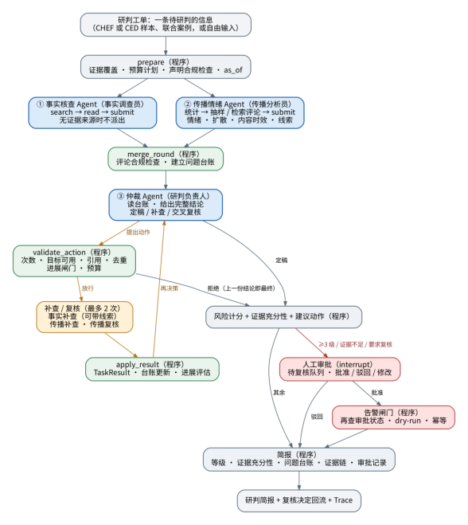
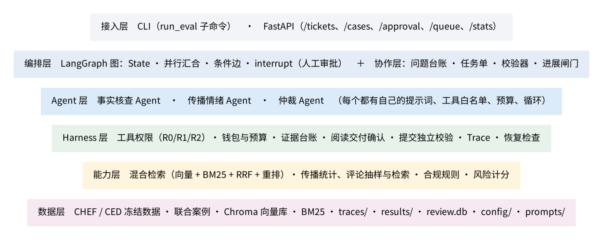

# 新闻研判系统架构

系统将新闻声明、可核对证据和可选传播材料组织成一张研判工单。事实、传播和仲裁三个模型角色分别负责调查与判断，程序负责材料资格、预算、协作动作、风险计算和人工复核。本文根据项目架构文档整理，并对照当前公开代码说明运行配置与真实新闻入口。

## 一张研判工单的完整流程

`prepare` 检查证据覆盖和预算条件，随后调度事实核查与传播分析。`merge_round` 汇合合格结果并建立问题台账，仲裁 Agent 根据台账选择定稿或提出补查、复核动作。程序经 `validate_action` 检查后执行任务，通过 `apply_result` 回填结果和进展，最终进入计分、人工复核及报告生成。

流程图展示了系统的完整分支。每次运行启用哪些分支由配置、证据覆盖、预算和校验结果决定。主要装配代码见 [graph/build.py](../src/yuqing/graph/build.py)。

| 图中环节 | 当前代码中的运行含义 |
|---|---|
| 补查与复核最多 2 次 | 对应 M6c 扩展配置的 `max_actions: 2`。默认协作配置为 `max_actions: 1`、目标为事实角色、复核关闭。扩展配置的存在不代表每次运行都会启用。 |
| 首轮事实与传播 | 图支持并行分支。证据覆盖为 `none` 时，路由仅调度传播分支。 |
| 人工审批 | `human_gate` 根据运行状态和审核规则决定是否暂停；批准或修改并通过校验后才能路由至告警门卫。 |
| 告警门卫 | 检查批准状态与动作权限。未装配处理器时返回阻止状态；实际外部告警能力取决于部署配置。 |
| 运行终点 | 生成简报，并保留台账、引文、执行记录及审批信息。异常路径依据已有材料收尾。 |

配置见 [weights.yaml](../config/weights.yaml)，审批与计分装配见 [graph/runtime.py](../src/yuqing/graph/runtime.py)。

## 六层职责

该图保留原架构文档的分层视角。接入层现已增加 Gradio 新闻工作台。图中的接口名称为功能简称，具体 URL 以代码中的路由声明为准，例如审批接口为 `/cases/{case_id}/approval`。

| 层 | 主要职责 | 代码入口 |
|---|---|---|
| 接入层 | 新闻输入、网页和评论候选审核、历史报告浏览，以及工单提交与审批 | [serve/research_ui.py](../src/yuqing/serve/research_ui.py)、[serve/api.py](../src/yuqing/serve/api.py) |
| 编排与协作层 | 调度角色、维护问题台账、校验任务与进展、管理人工暂停和恢复 | [graph/](../src/yuqing/graph/)、[collab/](../src/yuqing/collab/) |
| Agent 层 | 事实核查、传播样本分析与仲裁，各自使用提示词、工具和受限循环 | [agents/](../src/yuqing/agents/) |
| Harness 层 | 工具权限、费用预占、证据交付与引用校验、结构化提交、Trace | [harness/](../src/yuqing/harness/) |
| 能力层 | 混合检索、网页取证、评论抽样、合规检查及风险计分 | [retrieval/](../src/yuqing/retrieval/)、[features/](../src/yuqing/features/) |
| 数据层 | 案件材料、索引、配置、提示词、结果与账本 | [config/](../config/)、[prompts/](../prompts/)、本地运行目录 |

研究数据、模型索引和真实账本由运行者在本地管理。公开演示数据位于 [examples/synthetic/](../examples/synthetic/)，历史实验运行器位于 [experiments/archive/](../experiments/archive/)。

## 真实新闻入口如何接入

用户在 Gradio 输入具体声明，建立案件后查询和审核 Tavily 网页候选，并选择 YouTube 评论查询词和时间窗。材料选择绑定案件和采集回执，经逐案许可后进入调查流程。

事实 Agent 使用网页证据核查声明，公开材料传播模式分析本案可见评论。仲裁处理主图中的合格材料，程序完成风险计算。公开评论报告以独立样本附录呈现，保留原链接、时间窗、材料范围和 W 引用；总体传播规模与总体情绪继续按材料合同显示为不可用。

模型和取证请求使用案件账本记录费用与请求状态，前端读取实际执行记录展示进度。最终报告可回看事实 E 引文、公开材料 W 引文、角色结果和费用。统一入口和安装方式见 [QUICKSTART.md](QUICKSTART.md)。

这两张图采用项目提供的原始架构图。README 展示流程总览，本文承接详细分层与配置解释。
